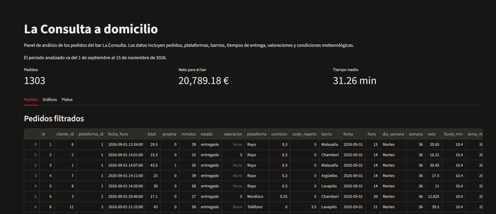
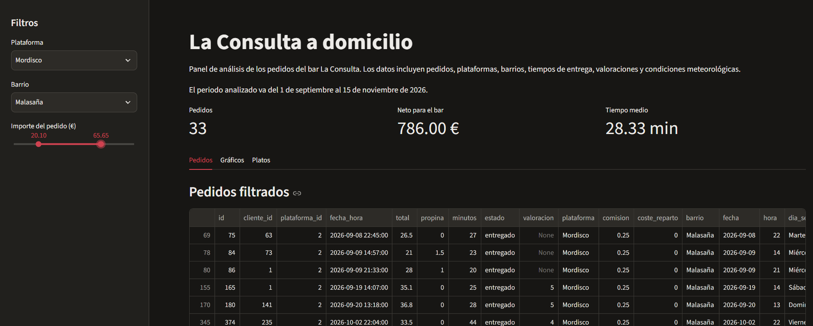
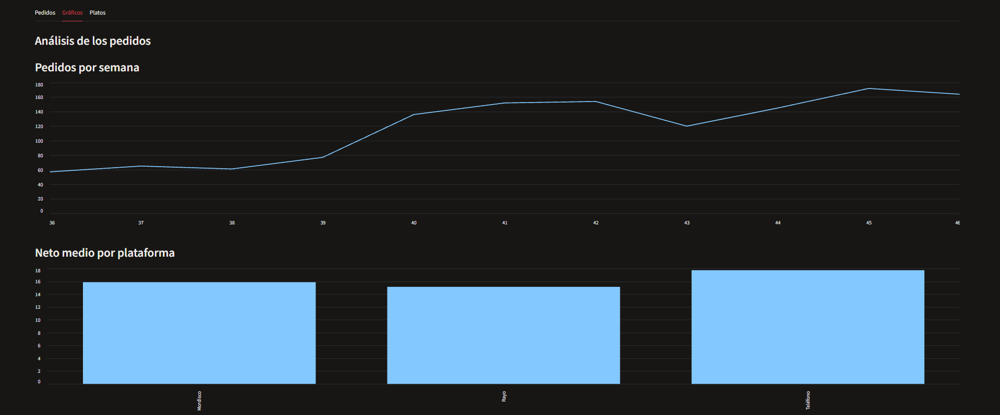
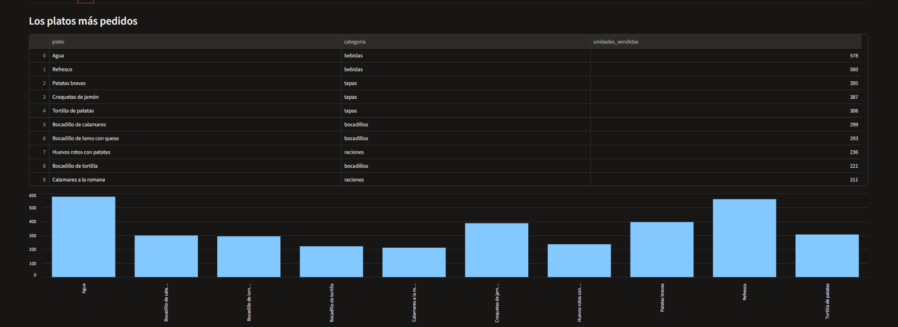
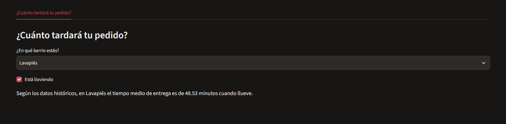

# La Consulta a domicilio

## Proyecto

Análisis de los pedidos de un bar ficticio llamado La Consulta. 
El objetivo es analizar los pedidos, las plataformas de reparto, los barrios, los tiempos de entrega, las valoraciones, la meteorología y los platos más vendidos, para obtener información que ayude a tomar decisiones.

El proyecto se ha desarrollado utilizando Python, Pandas, SQL, Matplotlib y Streamlit.

## Datos

Los datos proceden de una base de datos MySQL accesible a través de TiDB.

Se han realizado consultas SQL para obtener:

- Los pedidos, incluyendo información sobre clientes, barrios y plataformas.
- Los platos y las unidades vendidas, agrupados por plato y categoría.
- Los datos meteorológicos.
- Los totales de facturación por plataforma.

## Limpieza de datos

- Conversión de los importes a formato numérico.
- Conversión y normalización de las fechas.
- Normalización de los estados de los pedidos.
- Homogeneización de los nombres de los barrios.
- Eliminación de pedidos duplicados, ignorando el identificador.
- Sustitución de propinas nulas por 0.
- Tratamiento de tiempos de entrega inválidos (0 y 999).
- Conservación de valoraciones nulas.
- Creación de las columnas fecha y hora.
- Creación de la columna día de la semana.
- Creación de la columna semana.
- Cálculo del neto que recibe el bar descontando comisiones y costes de reparto.
- Incorporación de los datos meteorológicos.
- Creación de la variable llueve.
- Selección de los pedidos entregados para el análisis.

## Hallazgos

- **Rayo** es la plataforma que más pedidos aporta, con 607 pedidos entregados y 13.130,80 € facturados, aunque su neto medio por pedido (15,14 €) es el más bajo de las tres.
- **Chamberí** es el barrio con mayor demanda, con 548 pedidos, un tiempo medio de entrega de 25,82 minutos y una valoración media de 4,70.
- Los **días de lluvia** se registran una media de 29,69 pedidos frente a 16,56 en los días sin lluvia, mientras que Rayo presenta el mayor porcentaje de cancelaciones (7,04 %).

### Recomendación

Mantendría Rayo por su volumen de pedidos, priorizaría los repartos en Chamberí y revisaría los tiempos de entrega y las cancelaciones de Rayo, además de analizar cómo aprovechar el aumento de demanda en los días lluviosos.

### App

La aplicación permite filtrar los pedidos por plataforma, barrio e importe, consultar métricas, visualizar gráficos, conocer los platos más vendidos y obtener una estimación orientativa del tiempo de entrega según el barrio y la lluvia.

